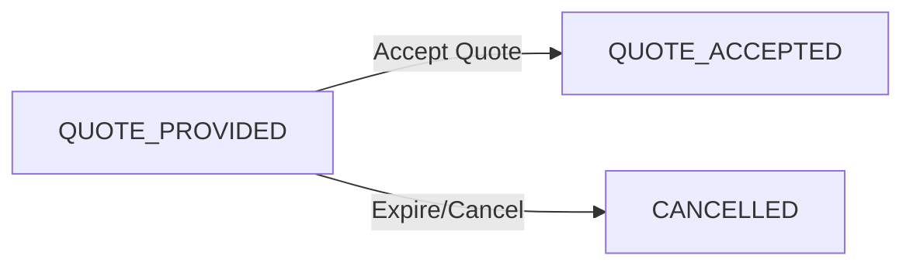

## Accept Payroll Quote

{: .endpoint-desc }
This endpoint allows a customer to accept the FX quote provided by the admin. The request must be in `QUOTE_PROVIDED` status and the quote must not have expired. Upon acceptance, the status changes to `QUOTE_ACCEPTED` and the payroll proceeds to execution.

### Request

```
Method: PATCH
URL: {{baseUrl}}/v1/customers/payroll/requests/:requestId/accept
Path Parameters: requestId - The unique identifier of the payroll request
Authentication: Requires Bearer token
```

### URL Parameters

| Parameter | Type | Required | Description |
|-----------|------|----------|-------------|
| `requestId` | UUID | ✅ | The unique identifier of the payroll request |

### Request Body

No request body required for this endpoint.

### Example Request

```bash
curl --location --request PATCH \
  'https://sandbox.api.relm.co/v1/customers/payroll/requests/babe5f2d-7c44-4b83-90b9-f94856ed4643/accept' \
  --header 'Authorization: Bearer <your_access_token>'
```

### Response

```
Status Code: 200 OK
Content-Type: application/json
```

### Response Body

**Response Description:** On successful acceptance, the server responds with a status code of 200 and the updated payroll request with status `QUOTE_ACCEPTED`.

```json
{
  "success": true,
  "data": {
    "id": "babe5f2d-7c44-4b83-90b9-f94856ed4643",
    "status": "QUOTE_ACCEPTED",
    "acceptedByCustomerAt": "2026-06-05T10:25:30.123Z",
    "quoteExpiresAt": "2026-06-05T18:00:00.000Z",
    "quotedAt": "2026-06-05T10:00:00.000Z",
    "quotedByUser": {
      "id": "a1b2c3d4-e5f6-7a8b-9c0d-1e2f3a4b5c6d",
      "firstName": "Admin",
      "lastName": "User",
      "email": "admin@relm.co"
    },
    "fxExchange": {
      "id": "f9e8d7c6-b5a4-3f2e-1d0c-9b8a7f6e5d4c",
      "payrollRequestId": "babe5f2d-7c44-4b83-90b9-f94856ed4643",
      "fromCurrencyCode": "AED",
      "toCurrencyCode": "PKR",
      "fromAmount": "5730.12",
      "toAmount": "460000.00",
      "exchangeRate": "80.2850",
      "recordedAt": "2026-06-05T10:00:00.000Z"
    },
    "sourceAccountCurrencyId": "385dec3a-9bfe-4072-8733-7872ef350e71",
    "payrollAccountCurrencyId": "fae535c5-f64f-4737-82de-c12b88be0764",
    "totalAmount": "5845.32",
    "estimatedReceivedAmount": "460000.00",
    "createdAt": "2026-06-05T09:15:30.123Z",
    "updatedAt": "2026-06-05T10:25:30.456Z"
  }
}
```

### Response Fields

- `success`: Boolean indicating request success
- `data`: Updated payroll request object
  - `id`: Payroll request UUID
  - `status`: Updated to `QUOTE_ACCEPTED`
  - `acceptedByCustomerAt`: Timestamp when customer accepted the quote
  - `quoteExpiresAt`: Expiration timestamp for the quote
  - `quotedAt`: When the admin provided the quote
  - `quotedByUser`: Admin user who provided the quote
  - `fxExchange`: Complete FX exchange details provided by admin
  - _(other fields omitted for brevity - see [Get Payroll Request](get-payroll-request) for full schema)_

### Status Transition



### Validation Rules

The following conditions must be met to accept a quote:

1. **Request Exists**: The payroll request must exist and belong to the authenticated customer
2. **Correct Status**: Request status must be exactly `QUOTE_PROVIDED`
3. **Not Expired**: The `quoteExpiresAt` timestamp must be in the future
4. **Ownership**: Only the customer who created the request can accept the quote

### Error Cases

#### 400 Bad Request

**Invalid status:**
```json
{
  "success": false,
  "error": {
    "code": "INVALID_STATUS",
    "message": "Request must be in QUOTE_PROVIDED status to accept. Current status: PENDING"
  }
}
```

**Quote expired:**
```json
{
  "success": false,
  "error": {
    "code": "QUOTE_EXPIRED",
    "message": "The quote has expired. Please contact support to receive a new quote."
  }
}
```

#### 401 Unauthorized

```json
{
  "success": false,
  "error": {
    "code": "UNAUTHORIZED",
    "message": "Invalid or expired authentication token"
  }
}
```

#### 404 Not Found

```json
{
  "success": false,
  "error": {
    "code": "NOT_FOUND",
    "message": "Payroll request not found or access denied"
  }
}
```

### Workflow Context

Understanding the complete flow helps clarify when to use this endpoint:

1. **Create Request**: Customer creates payroll request → status: `PENDING`
2. **Source Debit**: System debits source account and holds funds
3. **Admin Quote**: Admin reviews and provides actual FX rate → status: `QUOTE_PROVIDED`
4. **Customer Review**: Customer reviews the quote (rate, amounts, expiration)
5. **Accept Quote**: Customer calls this endpoint → status: `QUOTE_ACCEPTED`
6. **Execution**: System proceeds with currency conversion and beneficiary payouts

### Quote Expiration

Admin sets the `quoteExpiresAt` timestamp when providing the quote. This ensures:

- **Rate Protection**: Exchange rate is locked for a limited time
- **Market Risk**: Prevents stale rates from being used in volatile markets
- **Clear Deadlines**: Customer knows how long they have to decide

If the quote expires before acceptance:
- This endpoint will return a `QUOTE_EXPIRED` error
- Customer must contact admin for a new quote
- Admin can update the quote with a new expiration time

### Important Notes

- **Irrevocable**: Once accepted, the request proceeds to execution. Cancellation may not be possible after this point.
- **Execution Trigger**: Accepting the quote may trigger automatic execution, depending on system configuration
- **Quote Details**: Review the `fxExchange` object carefully before accepting to ensure rates are acceptable
- **Balance Impact**: Funds were already debited when the request was created - acceptance authorizes their distribution
- **No Partial Accept**: The entire quote must be accepted as-is; individual beneficiary amounts cannot be modified

### Next Steps After Acceptance

After successfully accepting the quote:

1. **Monitor Status**: Use [Get Payroll Request](get-payroll-request) to track status changes
2. **Track Transfers**: Use [List Payroll Transfers](list-payroll-transfers) to monitor individual beneficiary payouts
3. **Completion**: Wait for status to transition to `COMPLETED`, `PARTIALLY_COMPLETED`, or `FAILED`

### Related Endpoints

- [Get Payroll Request](get-payroll-request) — View complete request details including quote
- [Cancel Payroll Request](cancel-payroll-request) — Cancel before accepting quote
- [List Payroll Transfers](list-payroll-transfers) — Track individual beneficiary payouts
