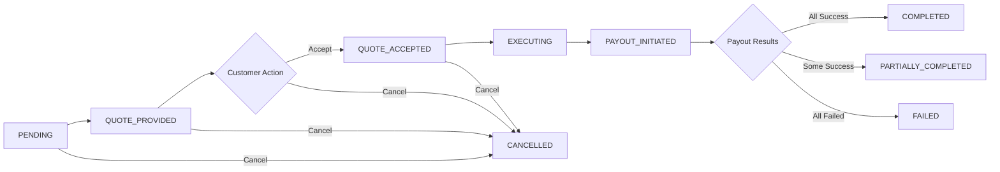

## Create Payroll Request

{: .endpoint-desc }
This endpoint initiates a payroll distribution to multiple beneficiaries. It requires a valid `feeHash` obtained from the **Estimate Payroll Fee** endpoint. Upon creation, funds are immediately debited from the source account and the request enters PENDING status awaiting admin quote.

### Request

```
Method: POST
URL: {{baseUrl}}/v1/customers/payroll/requests
Authentication: Requires Bearer token
Content-Type: application/json
```

### Request Body

```json
{
  "sourceAccountCurrencyId": "385dec3a-9bfe-4072-8733-7872ef350e71",
  "payrollAccountCurrencyId": "fae535c5-f64f-4737-82de-c12b88be0764",
  "feeHash": "a7c8f3d2-4b9e-4d1a-8f2c-9e7d6c5b4a3f",
  "amountSplitDetails": [
    {
      "beneficiaryId": "5b9d9177-2261-458d-b65b-c6722cc75a90",
      "amount": "5000.00",
      "purpose": "FCISS",
      "amountCurrencyType": "SOURCE"
    },
    {
      "beneficiaryId": "0db9b611-9754-454d-951d-d691e1265148",
      "amount": "150000.00",
      "purpose": "PEN",
      "amountCurrencyType": "PAYROLL"
    }
  ]
}
```

### Request Parameters

| Field | Type | Required | Description |
|-------|------|----------|-------------|
| `sourceAccountCurrencyId` | UUID | ✅ | The account currency ID from which funds will be debited |
| `payrollAccountCurrencyId` | UUID | ✅ | The payroll account currency ID |
| `feeHash` | UUID | ✅ | The fee hash obtained from the estimate endpoint |
| `amountSplitDetails` | Array | ✅ | List of beneficiary payment details |
| `amountSplitDetails[].beneficiaryId` | UUID | ✅ | The unique identifier of the beneficiary |
| `amountSplitDetails[].amount` | String (Decimal) | ✅ | Payment amount |
| `amountSplitDetails[].purpose` | String | ✅ | MCB purpose code (see below) |
| `amountSplitDetails[].amountCurrencyType` | Enum | ❌ | Currency type: `SOURCE` or `PAYROLL` (defaults to `SOURCE`) |

### Validation Rules

- All fields are required except `amountCurrencyType`
- `feeHash` must be valid and not expired
- `feeHash` can only be used once (consumed upon request creation)
- Source and payroll account currency IDs must match the estimate
- Amount split details must match the estimate
- Each `purpose` must be a valid MCB purpose code
- Customer must own the source account currency
- Source account must have sufficient available balance

### Example Request

```bash
curl --location 'https://sandbox.api.relm.co/v1/customers/payroll/requests' \
--header 'Content-Type: application/json' \
--header 'Authorization: Bearer <your_access_token>' \
--data '{
  "sourceAccountCurrencyId": "385dec3a-9bfe-4072-8733-7872ef350e71",
  "payrollAccountCurrencyId": "fae535c5-f64f-4737-82de-c12b88be0764",
  "feeHash": "a7c8f3d2-4b9e-4d1a-8f2c-9e7d6c5b4a3f",
  "amountSplitDetails": [
    {
      "beneficiaryId": "5b9d9177-2261-458d-b65b-c6722cc75a90",
      "amount": "5000.00",
      "purpose": "FCISS",
      "amountCurrencyType": "SOURCE"
    },
    {
      "beneficiaryId": "0db9b611-9754-454d-951d-d691e1265148",
      "amount": "150000.00",
      "purpose": "PEN",
      "amountCurrencyType": "PAYROLL"
    }
  ]
}'
```

### Response

```
Status Code: 201 Created
Content-Type: application/json
```

### Response Body

**Response Description:** On successful creation, the server responds with a status code of 201 and a JSON object containing the complete payroll request details.

```json
{
  "success": true,
  "data": {
    "id": "babe5f2d-7c44-4b83-90b9-f94856ed4643",
    "sourceAccountCurrencyId": "385dec3a-9bfe-4072-8733-7872ef350e71",
    "sourceAccountCurrency": {
      "id": "385dec3a-9bfe-4072-8733-7872ef350e71",
      "accountId": "fae535c5-f64f-4737-82de-c12b88be0764",
      "currency": {
        "id": "0ff5db18-ad57-4703-a031-08907aa814f1",
        "currencyCode": "AED",
        "currencyName": "United Arab Emirates Dirham",
        "currencySymbol": "د.إ"
      },
      "balance": "50000.00",
      "available": "44154.68",
      "account": {
        "id": "fae535c5-f64f-4737-82de-c12b88be0764",
        "accountProvider": "FUSE",
        "customerId": "c9a8b7d6-5e4f-3d2c-1b0a-9f8e7d6c5b4a"
      }
    },
    "payrollAccountCurrencyId": "fae535c5-f64f-4737-82de-c12b88be0764",
    "payrollAccountCurrency": {
      "id": "fae535c5-f64f-4737-82de-c12b88be0764",
      "currency": {
        "currencyCode": "PKR",
        "currencyName": "Pakistani Rupee"
      },
      "account": {
        "accountProvider": "MCB"
      }
    },
    "totalAmount": "5845.32",
    "status": "PENDING",
    "estimatedFxRate": "91.2450",
    "estimatedReceivedAmount": "457892.50",
    "sourceAmountForExchange": "5730.12",
    "metadata": {
      "feeBreakdown": {
        "sourceCurrencyAmount": "5000.00",
        "spreadFee": "75.00",
        "fuseFee": "40.20",
        "mcbFee": "730.12",
        "totalFee": "845.32",
        "estimatedReceivedAmount": "457892.50",
        "payrollCurrencyCode": "PKR",
        "feeCurrencyCode": "AED",
        "exchangeRate": "91.2450",
        "baseRate": "92.6210"
      }
    },
    "amountSplitDetails": [
      {
        "id": "d3c2b1a0-9f8e-7d6c-5b4a-3f2e1d0c9b8a",
        "beneficiaryId": "5b9d9177-2261-458d-b65b-c6722cc75a90",
        "beneficiarySnapshot": {
          "id": "5b9d9177-2261-458d-b65b-c6722cc75a90",
          "firstName": "Ahmed",
          "lastName": "Khan",
          "displayName": "Ahmed Khan",
          "type": "INDIVIDUAL",
          "iban": "PK36MUCB0000001234567890",
          "bankName": "MCB Bank",
          "nationality": "PK",
          "reference": "Freelancer Payment"
        },
        "sourceCurrencyAmount": "5000.00",
        "amount": "456062.50",
        "purposeCode": "FCISS",
        "payoutTransferId": "e4d3c2b1-0a9f-8e7d-6c5b-4a3f2e1d0c9b",
        "createdAt": "2026-06-05T09:15:30.123Z"
      },
      {
        "id": "f5e4d3c2-b1a0-9f8e-7d6c-5b4a3f2e1d0c",
        "beneficiaryId": "0db9b611-9754-454d-951d-d691e1265148",
        "beneficiarySnapshot": {
          "id": "0db9b611-9754-454d-951d-d691e1265148",
          "firstName": "Fatima",
          "lastName": "Ali",
          "displayName": "Fatima Ali",
          "type": "INDIVIDUAL",
          "accountNumber": "0987654321",
          "bankName": "MCB Bank",
          "nationality": "PK"
        },
        "sourceCurrencyAmount": "1644.12",
        "amount": "150000.00",
        "purposeCode": "PEN",
        "payoutTransferId": "g6f5e4d3-c2b1-a0a9-f8e7-d6c5b4a3f2e1",
        "createdAt": "2026-06-05T09:15:30.123Z"
      }
    ],
    "transfers": [
      {
        "id": "h7g6f5e4-d3c2-b1a0-9f8e-7d6c5b4a3f2e",
        "payrollRequestId": "babe5f2d-7c44-4b83-90b9-f94856ed4643",
        "transferType": "FUSE_INTERNAL_DEBIT",
        "status": "PROCESSING",
        "externalId": "fuse_tx_123456789",
        "amount": "5845.32",
        "currencyCode": "AED",
        "createdAt": "2026-06-05T09:15:30.456Z"
      },
      {
        "id": "e4d3c2b1-0a9f-8e7d-6c5b-4a3f2e1d0c9b",
        "payrollRequestId": "babe5f2d-7c44-4b83-90b9-f94856ed4643",
        "transferType": "MCB_TO_BENEFICIARY",
        "status": "PENDING",
        "amount": "456062.50",
        "currencyCode": "PKR",
        "createdAt": "2026-06-05T09:15:30.567Z"
      },
      {
        "id": "g6f5e4d3-c2b1-a0a9-f8e7-d6c5b4a3f2e1",
        "payrollRequestId": "babe5f2d-7c44-4b83-90b9-f94856ed4643",
        "transferType": "MCB_TO_BENEFICIARY",
        "status": "PENDING",
        "amount": "150000.00",
        "currencyCode": "PKR",
        "createdAt": "2026-06-05T09:15:30.678Z"
      }
    ],
    "customer": {
      "id": "c9a8b7d6-5e4f-3d2c-1b0a-9f8e7d6c5b4a",
      "firstName": "Business",
      "lastName": "Owner",
      "company": {
        "legalName": "Tech Innovations Ltd"
      }
    },
    "createdAt": "2026-06-05T09:15:30.123Z",
    "updatedAt": "2026-06-05T09:15:30.789Z"
  }
}
```

### Response Fields

- `success`: Boolean indicating request success
- `data`: Complete payroll request object
  - `id`: Unique identifier for this payroll request
  - `sourceAccountCurrencyId`: Source account currency UUID
  - `sourceAccountCurrency`: Detailed source account information including balance and currency details
  - `payrollAccountCurrencyId`: Payroll account currency UUID
  - `payrollAccountCurrency`: Detailed payroll account information
  - `totalAmount`: Total debited from source account (includes all fees)
  - `status`: Current request status (initially `PENDING`)
  - `estimatedFxRate`: Estimated exchange rate (actual rate provided later in quote)
  - `estimatedReceivedAmount`: Total amount beneficiaries expected to receive
  - `sourceAmountForExchange`: Amount available for FX conversion (total - spread fee - fuse fee)
  - `metadata`: Contains detailed fee breakdown
  - `amountSplitDetails`: Array of per-beneficiary payment instructions with snapshots
  - `transfers`: Array of related transfers (source debit + beneficiary payout placeholders)
  - `customer`: Customer details
  - `createdAt`: Request creation timestamp
  - `updatedAt`: Last update timestamp

### Business Logic Flow

The request creation process executes the following steps:

#### 1. Fee Hash Validation
- Retrieves fee hash data from Redis cache
- Validates hash has not expired
- Confirms account currency IDs match the estimate
- **Deletes the hash** to prevent reuse (one-time consumption)

#### 2. Precondition Checks
- Verifies customer owns the source account currency
- Validates source account has sufficient available balance
- Confirms all beneficiaries exist and match the estimate
- Validates all purpose codes are valid MCB codes

#### 3. PayrollRequest Creation
- Creates main PayrollRequest record with status `PENDING`
- Stores complete fee breakdown in metadata field
- Records estimated exchange rate and expected amounts

#### 4. Amount Split Creation
- Creates PayrollAmountSplit record for each beneficiary
- **Captures immutable beneficiary snapshot** (name, account details, etc.)
- Stores both source and payroll currency amounts
- Links to MCB purpose code for compliance

#### 5. Transfer Placeholder Creation
- Creates `MCB_TO_BENEFICIARY` transfer placeholders (status: `PENDING`)
- One placeholder per beneficiary for tracking
- Links each placeholder to corresponding amount split

#### 6. Source Transfer Initiation
- Creates `FUSE_INTERNAL_DEBIT` transfer for total amount
- Submits payment to XBD internal Fuse account
- Updates transfer status to `PROCESSING` with external transaction ID
- Records pending transaction against source account currency

### Status Workflow



### Cancellable Statuses

Requests can be cancelled by the customer or admin when in the following statuses:
- `PENDING`
- `QUOTE_PROVIDED`
- `QUOTE_ACCEPTED`

Once execution begins (`EXECUTING` or later), cancellation is no longer possible.

### MCB Purpose Codes

The `purpose` field must be one of the following valid MCB codes:

| Purpose Code | Numeric Code | Description |
|--------------|--------------|-------------|
| `FCISS` | 9186 | Freelance of Computer and Information Systems Services |
| `PEN` | 9477 | Pension Transactions |
| `OFS` | 9249 | Other Freelance Services |

For complete purpose code reference, see [Enums & Types](enums-and-types#mcb-purpose-codes).

### Beneficiary Snapshots

Each `amountSplitDetails` entry includes a `beneficiarySnapshot` field containing an immutable copy of the beneficiary's details at the time of request creation:

```json
{
  "beneficiarySnapshot": {
    "id": "uuid",
    "firstName": "string",
    "lastName": "string",
    "displayName": "string",
    "type": "INDIVIDUAL|BUSINESS",
    "iban": "string",
    "accountNumber": "string",
    "routingNumber": "string",
    "bankName": "string",
    "nationality": "string",
    "reference": "string"
  }
}
```

**Purpose**: Ensures historical accuracy even if beneficiary details are updated later. Critical for audit, compliance, and dispute resolution.

### Error Cases

#### 400 Bad Request

**Invalid or expired fee hash:**
```json
{
  "success": false,
  "error": {
    "code": "INVALID_FEE_HASH",
    "message": "Fee hash is invalid or has expired"
  }
}
```

**Insufficient balance:**
```json
{
  "success": false,
  "error": {
    "code": "INSUFFICIENT_BALANCE",
    "message": "Source account has insufficient available balance"
  }
}
```

**Invalid purpose code:**
```json
{
  "success": false,
  "error": {
    "code": "VALIDATION_ERROR",
    "message": "Invalid MCB purpose code. Must be one of: FCISS, PEN, OFS"
  }
}
```

#### 401 Unauthorized

```json
{
  "success": false,
  "error": {
    "code": "UNAUTHORIZED",
    "message": "Invalid or expired authentication token"
  }
}
```

#### 403 Forbidden

**Customer doesn't own source account:**
```json
{
  "success": false,
  "error": {
    "code": "FORBIDDEN",
    "message": "Source account currency does not belong to authenticated customer"
  }
}
```

#### 404 Not Found

**Beneficiary not found:**
```json
{
  "success": false,
  "error": {
    "code": "NOT_FOUND",
    "message": "One or more beneficiaries not found"
  }
}
```

### Important Notes

- **Fee Hash**: Consumed immediately upon request creation (cannot be reused)
- **Source Funds**: Debited immediately and held for the payroll
- **Quote Workflow**: After creation, wait for admin to provide FX quote (status changes to `QUOTE_PROVIDED`)
- **Beneficiary Snapshots**: Stored permanently for compliance and audit purposes
- **Transfer Tracking**: Monitor individual beneficiary payouts via the [List Payroll Transfers](list-payroll-transfers) endpoint
- **Balance Impact**: Source account's available balance is reduced immediately, even though beneficiaries haven't been paid yet
