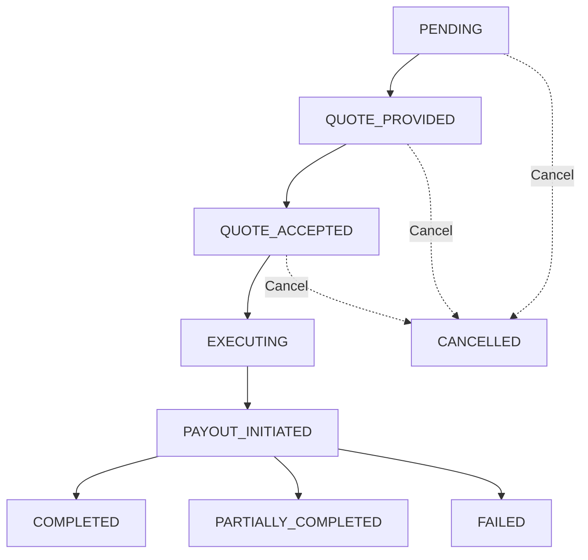
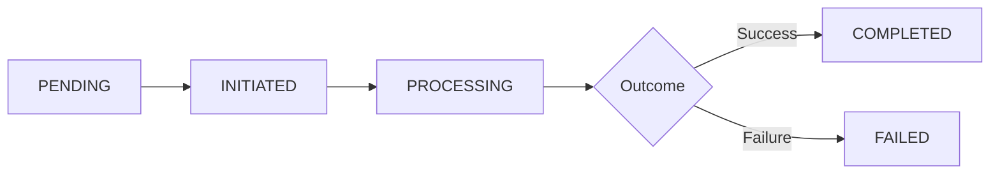
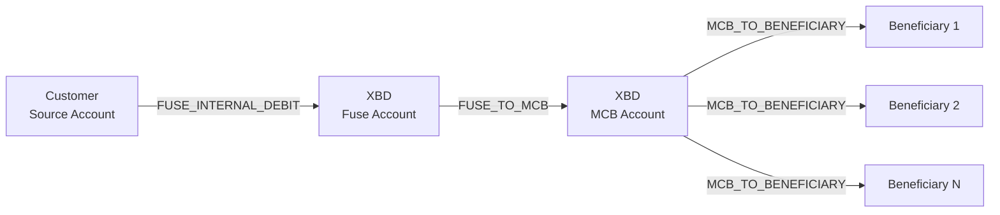

## Enums & Types

This page documents all enumeration types, status values, and reference data used across the Payroll API.

---

## PayrollRequestStatus

Represents the current state of a payroll request throughout its lifecycle.

| Status | Description | Can Accept Quote | Can Cancel | Next Possible States |
|--------|-------------|------------------|------------|---------------------|
| `PENDING` | Request created, source funds debited, awaiting admin quote | No | Yes | QUOTE_PROVIDED, CANCELLED |
| `QUOTE_PROVIDED` | Admin has provided FX exchange quote | Yes | Yes | QUOTE_ACCEPTED, CANCELLED |
| `QUOTE_ACCEPTED` | Customer accepted the quote, awaiting execution | No | Yes | EXECUTING, CANCELLED |
| `EXECUTING` | Currency conversion and transfer preparation in progress | No | No | PAYOUT_INITIATED |
| `PAYOUT_INITIATED` | Individual beneficiary payouts have been initiated | No | No | COMPLETED, PARTIALLY_COMPLETED, FAILED |
| `COMPLETED` | All beneficiaries successfully paid | No | No | _(terminal state)_ |
| `PARTIALLY_COMPLETED` | Some beneficiaries paid, others failed | No | No | _(terminal state)_ |
| `FAILED` | Request failed completely | No | No | _(terminal state)_ |
| `CANCELLED` | Request cancelled by customer or admin | No | No | _(terminal state)_ |

### Terminal States

Once a request reaches a terminal state, it cannot transition to any other status:
- `COMPLETED`
- `PARTIALLY_COMPLETED`
- `FAILED`
- `CANCELLED`

### Workflow Diagram



---

## PayrollTransferStatus

Represents the current state of an individual transfer within a payroll request.

| Status | Description | Is Terminal | Notes |
|--------|-------------|-------------|-------|
| `PENDING` | Transfer created but not yet submitted | No | Initial state for placeholder transfers |
| `INITIATED` | Transfer added to payment provider batch | No | Queued for submission |
| `PROCESSING` | Transfer submitted to payment provider and being processed | No | Active processing |
| `COMPLETED` | Transfer successfully completed | Yes | Beneficiary has been paid |
| `FAILED` | Transfer failed | Yes | See `failureReason` for details |

### Transfer Lifecycle



---

## PayrollTransferType

Indicates the type and direction of a payroll-related transfer.

| Type | Direction | Description |
|------|-----------|-------------|
| `FUSE_INTERNAL_DEBIT` | Customer → XBD | Debit from customer's source account via Fuse provider |
| `FUSE_TO_MCB` | XBD → MCB | Transfer of funds from XBD's Fuse account to MCB primary account |
| `MCB_TO_BENEFICIARY` | MCB → Beneficiary | Individual payout from MCB to beneficiary |

### Transfer Flow



### Transfer Type Characteristics

| Type | Count per Request | Visibility | Status Tracking |
|------|-------------------|------------|-----------------|
| `FUSE_INTERNAL_DEBIT` | 1 | Customer & Admin | Real-time via Fuse |
| `FUSE_TO_MCB` | 1 | Admin only | Real-time via Fuse |
| `MCB_TO_BENEFICIARY` | N (one per beneficiary) | Customer & Admin | Real-time via MCB |

---

## PayrollAmountCurrencyType

Specifies which currency an amount is denominated in within a payroll request.

| Type | Description | Use Case |
|------|-------------|----------|
| `SOURCE` | Amount is in the source account currency | Customer knows exactly how much to deduct from source account |
| `PAYROLL` | Amount is in the payroll/beneficiary currency | Customer knows exactly how much beneficiary should receive |

### Examples

**SOURCE Currency Example:**
```json
{
  "beneficiaryId": "abc123",
  "amount": "1000.00",
  "amountCurrencyType": "SOURCE"
}
```
- Customer's AED account will be debited 1,000 AED (plus fees) for this beneficiary
- System calculates PKR amount based on exchange rate

**PAYROLL Currency Example:**
```json
{
  "beneficiaryId": "def456",
  "amount": "50000.00",
  "amountCurrencyType": "PAYROLL"
}
```
- Beneficiary will receive exactly 50,000 PKR
- System calculates required AED debit based on exchange rate

### Default Behavior

If `amountCurrencyType` is omitted, it defaults to `SOURCE`.

### Validation Rules

- **SOURCE amounts**: Maximum 8 decimal places
- **PAYROLL amounts**: Maximum 2 decimal places (standard for PKR)

---

## MCB Purpose Codes

MCB (Mauritius Commercial Bank) requires a purpose code for each beneficiary transfer for regulatory compliance.

### Valid Purpose Codes

| Purpose Code | Numeric Code | Description | Typical Use |
|--------------|--------------|-------------|-------------|
| `FCISS` | 9186 | Freelance of Computer and Information Systems Services | Software developers, IT consultants, web designers |
| `PEN` | 9477 | Pension Transactions | Retirement payments, pension distributions |
| `OFS` | 9249 | Other Freelance Services | Writers, designers, consultants, other freelance work |

### Usage Requirements

- **Required**: Every beneficiary in a payroll request must have a valid purpose code
- **Format**: Use the string code (e.g., `"FCISS"`) not the numeric code
- **Compliance**: Accurate purpose codes ensure regulatory compliance
- **Immutable**: Purpose code is captured in beneficiary snapshot and cannot be changed

### Example Usage

```json
{
  "amountSplitDetails": [
    {
      "beneficiaryId": "abc-123",
      "amount": "5000.00",
      "purpose": "FCISS",
      "amountCurrencyType": "SOURCE"
    },
    {
      "beneficiaryId": "def-456",
      "amount": "150000.00",
      "purpose": "PEN",
      "amountCurrencyType": "PAYROLL"
    },
    {
      "beneficiaryId": "ghi-789",
      "amount": "3000.00",
      "purpose": "OFS",
      "amountCurrencyType": "SOURCE"
    }
  ]
}
```

### Selection Guidelines

| Beneficiary Type | Recommended Code |
|------------------|------------------|
| Software Developer, Programmer | `FCISS` |
| IT Consultant, Systems Analyst | `FCISS` |
| Retiree, Pensioner | `PEN` |
| Writer, Content Creator | `OFS` |
| Graphic Designer | `OFS` |
| Marketing Consultant | `OFS` |
| General Freelancer | `OFS` |

---

## BeneficiaryType

Indicates whether a beneficiary is an individual or a business entity.

| Type | Description |
|------|-------------|
| `INDIVIDUAL` | Individual person (most common for payroll) |
| `BUSINESS` | Business entity or company |

**Note**: This is part of the beneficiary snapshot stored with each payroll amount split.

---

## AccountProvider

Identifies the banking or payment provider for an account.

| Provider | Description | Used For |
|----------|-------------|----------|
| `FUSE` | Fuse payment provider | Source accounts (customer funds) |
| `MCB` | Mauritius Commercial Bank | Payroll accounts (beneficiary payouts) |
| `ZAND` | Zand Bank | Alternative source accounts |

---

## Fee Breakdown Structure

The fee breakdown in payroll request metadata contains:

```typescript
{
  feeBreakdown: {
    sourceCurrencyAmount: string;      // Base amount before fees
    spreadFee: string;                 // FX spread markup
    fuseFee: string;                   // Payment processor fee
    mcbFee: string;                    // Bank transfer fees (per beneficiary)
    totalFee: string;                  // Sum of all fees
    estimatedReceivedAmount: string;   // Total beneficiaries will receive
    payrollCurrencyCode: string;       // Currency code (e.g., "PKR")
    feeCurrencyCode: string;           // Fee currency (e.g., "AED")
    exchangeRate: string;              // Effective rate (with spread)
    baseRate: string;                  // Base rate before spread
  }
}
```

### Fee Components

| Component | Currency | Calculation |
|-----------|----------|-------------|
| `spreadFee` | Source | `sourceCurrencyAmount × (spreadBips / 10000)` |
| `fuseFee` | Source | Estimated by Fuse provider |
| `mcbFee` | Source | `(fixedFeePerBeneficiary × beneficiaryCount)` converted from PKR |
| `totalFee` | Source | `spreadFee + fuseFee + mcbFee` |

---

## Error Codes

Common error codes returned by Payroll API endpoints:

| Code | HTTP Status | Description |
|------|-------------|-------------|
| `VALIDATION_ERROR` | 400 | Invalid request parameters |
| `INVALID_FEE_HASH` | 400 | Fee hash is invalid or expired |
| `INSUFFICIENT_BALANCE` | 400 | Source account has insufficient funds |
| `INVALID_STATUS` | 400 | Operation not allowed in current status |
| `QUOTE_EXPIRED` | 400 | Quote has expired |
| `EXCHANGE_RATE_UNAVAILABLE` | 400 | Unable to retrieve exchange rate |
| `UNAUTHORIZED` | 401 | Invalid or expired authentication token |
| `FORBIDDEN` | 403 | Access denied to resource |
| `NOT_FOUND` | 404 | Resource not found |
| `INTERNAL_ERROR` | 500 | Unexpected server error |

---

## Date & Time Format

All timestamps use **ISO 8601** format with timezone:

```
2026-06-05T10:35:30.123Z
```

- **Format**: `YYYY-MM-DDTHH:mm:ss.sssZ`
- **Timezone**: UTC (indicated by `Z`)
- **Precision**: Milliseconds

### Examples

```json
{
  "createdAt": "2026-06-05T09:15:30.123Z",
  "quoteExpiresAt": "2026-06-05T18:00:00.000Z",
  "acceptedByCustomerAt": "2026-06-05T10:25:30.456Z"
}
```

---

## Currency Codes

Payroll API currently supports the following currency pairs:

### Source Currencies (Customer Accounts)

| Code | Name | Symbol |
|------|------|--------|
| `AED` | United Arab Emirates Dirham | د.إ |
| `USD` | United States Dollar | $ |
| `EUR` | Euro | € |
| `GBP` | British Pound Sterling | £ |

### Payroll Currencies (Beneficiary Payouts)

| Code | Name | Symbol |
|------|------|--------|
| `PKR` | Pakistani Rupee | ₨ |

**Note**: Payroll distributions are currently processed through MCB in PKR. Additional currencies may be added in the future.

---

## Decimal Precision

Different fields have specific decimal precision requirements:

| Field Type | Max Decimals | Examples |
|------------|--------------|----------|
| Source currency amounts | 8 | `1234.56789012` |
| Payroll currency amounts (PKR) | 2 | `150000.00` |
| Exchange rates | 4 | `91.2450` |
| Fee amounts | 2 | `845.32` |

---

## Related Documentation

- [Payroll API Overview](../payroll-api) — Complete workflow and concepts
- [Create Payroll Request](create-payroll-request) — Status workflow details
- [List Payroll Transfers](list-payroll-transfers) — Transfer status tracking
