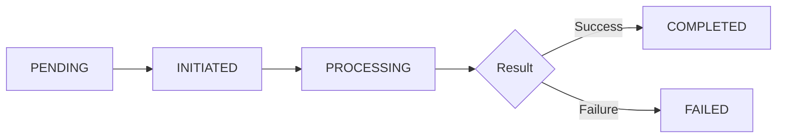

## List Payroll Transfers

{: .endpoint-desc }
This endpoint retrieves a paginated list of individual beneficiary payroll transfers for the authenticated customer. Each transfer represents a payout to a single beneficiary. Supports filtering by status, date range, and search by transfer ID or beneficiary name.

### Request

```
Method: GET
URL: {{baseUrl}}/v1/customers/payroll/transfers
Authentication: Requires Bearer token
```

### Query Parameters

| Parameter | Type | Required | Description |
|-----------|------|----------|-------------|
| `status` | String | ❌ | Comma-separated list of transfer statuses |
| `startDate` | ISO8601 | ❌ | Filter transfers created on or after this date |
| `endDate` | ISO8601 | ❌ | Filter transfers created on or before this date |
| `search` | String | ❌ | Search by transfer ID or beneficiary name |
| `page` | Integer | ❌ | Page number (default: 1) |
| `limit` | Integer | ❌ | Results per page (default: 20, max: 100) |
| `sort` | String | ❌ | Sort order: `asc` or `desc` (default: `desc`) |

### Status Filter Values

Filter by one or more of the following status values (comma-separated):
- `PENDING` - Created but not yet submitted to MCB
- `INITIATED` - Added to MCB instruction batch
- `PROCESSING` - Submitted to MCB and processing
- `COMPLETED` - Successfully paid to beneficiary
- `FAILED` - Payment failed

For detailed status descriptions, see [Enums & Types](enums-and-types#payroll-transfer-status).

### Example Requests

**List all transfers:**
```bash
curl --location 'https://sandbox.api.relm.co/v1/customers/payroll/transfers' \
  --header 'Authorization: Bearer <your_access_token>'
```

**Filter by status:**
```bash
curl --location 'https://sandbox.api.relm.co/v1/customers/payroll/transfers?status=COMPLETED,PROCESSING' \
  --header 'Authorization: Bearer <your_access_token>'
```

**Filter by date range:**
```bash
curl --location 'https://sandbox.api.relm.co/v1/customers/payroll/transfers?startDate=2026-06-01T00:00:00Z&endDate=2026-06-05T23:59:59Z' \
  --header 'Authorization: Bearer <your_access_token>'
```

**Search by beneficiary name:**
```bash
curl --location 'https://sandbox.api.relm.co/v1/customers/payroll/transfers?search=Ahmed' \
  --header 'Authorization: Bearer <your_access_token>'
```

**Combined filters with pagination:**
```bash
curl --location 'https://sandbox.api.relm.co/v1/customers/payroll/transfers?status=COMPLETED&startDate=2026-06-01T00:00:00Z&page=1&limit=10&sort=desc' \
  --header 'Authorization: Bearer <your_access_token>'
```

### Response

```
Status Code: 200 OK
Content-Type: application/json
```

### Response Body

**Response Description:** Returns a paginated list of MCB-to-beneficiary transfers with payout details.

```json
{
  "success": true,
  "data": [
    {
      "id": "e4d3c2b1-0a9f-8e7d-6c5b-4a3f2e1d0c9b",
      "payrollRequestId": "babe5f2d-7c44-4b83-90b9-f94856ed4643",
      "transferType": "MCB_TO_BENEFICIARY",
      "status": "COMPLETED",
      "externalId": "mcb_tx_987654321",
      "amount": "456062.50",
      "currencyCode": "PKR",
      "feeDetails": {
        "id": "j9i8h7g6-f5e4-d3c2-b1a0-9f8e7d6c5b4a",
        "amount": "100.00",
        "finalInternalFee": "100.00"
      },
      "failureReason": null,
      "metadata": {},
      "executedAt": "2026-06-05T10:35:00.000Z",
      "completedAt": "2026-06-05T10:37:30.000Z",
      "payoutInstruction": {
        "id": "d3c2b1a0-9f8e-7d6c-5b4a-3f2e1d0c9b8a",
        "beneficiaryId": "5b9d9177-2261-458d-b65b-c6722cc75a90",
        "beneficiarySnapshot": {
          "id": "5b9d9177-2261-458d-b65b-c6722cc75a90",
          "firstName": "Ahmed",
          "lastName": "Khan",
          "displayName": "Ahmed Khan",
          "iban": "PK36MUCB0000001234567890",
          "bankName": "MCB Bank",
          "type": "INDIVIDUAL"
        },
        "sourceCurrencyAmount": "5000.00",
        "amount": "456062.50"
      },
      "payrollRequest": {
        "id": "babe5f2d-7c44-4b83-90b9-f94856ed4643",
        "status": "COMPLETED",
        "totalAmount": "5845.32",
        "sourceAccountCurrency": {
          "id": "385dec3a-9bfe-4072-8733-7872ef350e71",
          "currency": {
            "currencyCode": "AED",
            "currencyName": "United Arab Emirates Dirham"
          }
        }
      },
      "createdAt": "2026-06-05T09:15:30.567Z",
      "updatedAt": "2026-06-05T10:37:30.890Z"
    },
    {
      "id": "g6f5e4d3-c2b1-a0a9-f8e7-d6c5b4a3f2e1",
      "payrollRequestId": "babe5f2d-7c44-4b83-90b9-f94856ed4643",
      "transferType": "MCB_TO_BENEFICIARY",
      "status": "PROCESSING",
      "externalId": "mcb_tx_123456789",
      "amount": "150000.00",
      "currencyCode": "PKR",
      "feeDetails": {
        "id": "k0j9i8h7-g6f5-e4d3-c2b1-a0a9f8e7d6c5",
        "amount": "100.00",
        "finalInternalFee": "100.00"
      },
      "failureReason": null,
      "metadata": {},
      "executedAt": "2026-06-05T10:35:05.000Z",
      "completedAt": null,
      "payoutInstruction": {
        "id": "f5e4d3c2-b1a0-9f8e-7d6c-5b4a3f2e1d0c",
        "beneficiaryId": "0db9b611-9754-454d-951d-d691e1265148",
        "beneficiarySnapshot": {
          "id": "0db9b611-9754-454d-951d-d691e1265148",
          "firstName": "Fatima",
          "lastName": "Ali",
          "displayName": "Fatima Ali",
          "accountNumber": "0987654321",
          "bankName": "MCB Bank",
          "type": "INDIVIDUAL"
        },
        "sourceCurrencyAmount": "1644.12",
        "amount": "150000.00"
      },
      "payrollRequest": {
        "id": "babe5f2d-7c44-4b83-90b9-f94856ed4643",
        "status": "PAYOUT_INITIATED",
        "totalAmount": "5845.32",
        "sourceAccountCurrency": {
          "id": "385dec3a-9bfe-4072-8733-7872ef350e71",
          "currency": {
            "currencyCode": "AED",
            "currencyName": "United Arab Emirates Dirham"
          }
        }
      },
      "createdAt": "2026-06-05T09:15:30.678Z",
      "updatedAt": "2026-06-05T10:35:05.123Z"
    }
  ],
  "pagination": {
    "page": 1,
    "limit": 20,
    "total": 47,
    "totalPages": 3,
    "hasNextPage": true,
    "hasPreviousPage": false
  }
}
```

### Response Fields

#### Data Array

Each transfer in the `data` array contains:

| Field | Type | Description |
|-------|------|-------------|
| `id` | UUID | Unique identifier for the transfer |
| `payrollRequestId` | UUID | Parent payroll request ID |
| `transferType` | Enum | Always `MCB_TO_BENEFICIARY` for this endpoint |
| `status` | Enum | Current transfer status |
| `externalId` | String | External system transaction ID (from MCB) |
| `amount` | Decimal | Transfer amount in payroll currency |
| `currencyCode` | String | Currency code (typically PKR) |
| `feeDetails` | Object | Fee information for this transfer |
| `failureReason` | String | Reason for failure (if status is FAILED) |
| `metadata` | Object | Additional transfer metadata |
| `executedAt` | ISO8601 | When transfer execution started |
| `completedAt` | ISO8601 | When transfer completed (null if not completed) |
| `payoutInstruction` | Object | Beneficiary payout details |
| `payrollRequest` | Object | Parent payroll request summary |
| `createdAt` | ISO8601 | Transfer creation timestamp |
| `updatedAt` | ISO8601 | Last update timestamp |

#### Payout Instruction Object

| Field | Type | Description |
|-------|------|-------------|
| `id` | UUID | Amount split ID (links to payroll request) |
| `beneficiaryId` | UUID | Beneficiary reference |
| `beneficiarySnapshot` | Object | Immutable beneficiary details at request time |
| `sourceCurrencyAmount` | Decimal | Amount in source currency |
| `amount` | Decimal | Amount in payroll currency |

#### Payroll Request Object

| Field | Type | Description |
|-------|------|-------------|
| `id` | UUID | Payroll request ID |
| `status` | Enum | Current request status |
| `totalAmount` | Decimal | Total request amount |
| `sourceAccountCurrency` | Object | Source account currency details |

#### Pagination Object

| Field | Type | Description |
|-------|------|-------------|
| `page` | Integer | Current page number |
| `limit` | Integer | Results per page |
| `total` | Integer | Total number of transfers matching filters |
| `totalPages` | Integer | Total number of pages |
| `hasNextPage` | Boolean | Whether there are more results |
| `hasPreviousPage` | Boolean | Whether there are previous results |

### Transfer Status Workflow



| Status | Description |
|--------|-------------|
| `PENDING` | Created as placeholder, not yet submitted to MCB |
| `INITIATED` | Added to MCB instruction batch |
| `PROCESSING` | Submitted to MCB and processing |
| `COMPLETED` | Successfully paid to beneficiary |
| `FAILED` | Payment failed (see `failureReason` for details) |

### Search Behavior

The `search` parameter performs a case-insensitive search on:
- **Transfer ID**: Exact UUID match
- **Beneficiary Display Name**: Substring match in `beneficiarySnapshot.displayName`

Example searches:
```bash
# Search by transfer ID
?search=e4d3c2b1-0a9f-8e7d-6c5b-4a3f2e1d0c9b

# Search by beneficiary name (partial match)
?search=Ahmed

# Search by beneficiary name (case-insensitive)
?search=khan
```

### Date Range Filtering

Filter transfers by creation date:

```bash
# Last 7 days
?startDate=2026-05-29T00:00:00Z&endDate=2026-06-05T23:59:59Z

# Specific month
?startDate=2026-05-01T00:00:00Z&endDate=2026-05-31T23:59:59Z

# After specific date
?startDate=2026-06-01T00:00:00Z
```

### Error Cases

#### 400 Bad Request

**Invalid status value:**
```json
{
  "success": false,
  "error": {
    "code": "VALIDATION_ERROR",
    "message": "Invalid status value. Must be one of: PENDING, INITIATED, PROCESSING, COMPLETED, FAILED"
  }
}
```

**Invalid date format:**
```json
{
  "success": false,
  "error": {
    "code": "VALIDATION_ERROR",
    "message": "startDate must be a valid ISO 8601 datetime"
  }
}
```

#### 401 Unauthorized

```json
{
  "success": false,
  "error": {
    "code": "UNAUTHORIZED",
    "message": "Invalid or expired authentication token"
  }
}
```

### Use Cases

#### Monitor Active Payouts

Track in-progress beneficiary payouts:

```bash
curl --location 'https://sandbox.api.relm.co/v1/customers/payroll/transfers?status=PROCESSING,INITIATED' \
  --header 'Authorization: Bearer <your_access_token>'
```

#### Verify Completed Payouts

Review successfully completed transfers for reconciliation:

```bash
curl --location 'https://sandbox.api.relm.co/v1/customers/payroll/transfers?status=COMPLETED&startDate=2026-06-01T00:00:00Z' \
  --header 'Authorization: Bearer <your_access_token>'
```

#### Investigate Failed Transfers

Find failed transfers for support investigation:

```bash
curl --location 'https://sandbox.api.relm.co/v1/customers/payroll/transfers?status=FAILED' \
  --header 'Authorization: Bearer <your_access_token>'
```

#### Track Specific Beneficiary

Search for all transfers to a specific beneficiary:

```bash
curl --location 'https://sandbox.api.relm.co/v1/customers/payroll/transfers?search=Ahmed%20Khan' \
  --header 'Authorization: Bearer <your_access_token>'
```

#### Generate Monthly Report

Get all transfers for a specific month:

```bash
curl --location 'https://sandbox.api.relm.co/v1/customers/payroll/transfers?startDate=2026-05-01T00:00:00Z&endDate=2026-05-31T23:59:59Z&limit=100' \
  --header 'Authorization: Bearer <your_access_token>'
```

### Sorting

Results are sorted by `createdAt`:
- **desc** (default): Newest transfers first
- **asc**: Oldest transfers first

### Important Notes

- **Transfer Type**: Only returns `MCB_TO_BENEFICIARY` transfers (individual beneficiary payouts)
- **Customer Scope**: Only returns transfers from payroll requests belonging to the authenticated customer
- **Status Filtering**: Can filter by multiple statuses using comma-separated values
- **Beneficiary Snapshots**: Immutable copies preserved for historical accuracy
- **Fee Details**: Each transfer has associated fee information
- **Parent Request**: Use `payrollRequestId` to link transfers back to their payroll request

### Performance Considerations

- **Default Limit**: 20 results per page for optimal performance
- **Maximum Limit**: 100 results per page
- **Date Range**: Using date filters improves query performance
- **Status Filter**: Reduces result set and speeds up response
- **Search**: Case-insensitive search may be slower on large datasets

### Polling for Updates

When monitoring transfer status, use appropriate polling intervals:

```javascript
// Poll every 30 seconds while transfers are in PROCESSING status
async function monitorTransfers(payrollRequestId) {
  let allCompleted = false;
  
  while (!allCompleted) {
    const response = await fetch(
      'https://sandbox.api.relm.co/v1/customers/payroll/transfers?' +
      `status=PROCESSING,INITIATED&search=${payrollRequestId}`,
      {
        headers: { 'Authorization': `Bearer ${accessToken}` }
      }
    );
    
    const { data } = await response.json();
    
    if (data.length === 0) {
      allCompleted = true;
      console.log('All transfers completed');
    } else {
      console.log(`${data.length} transfers still processing`);
      await new Promise(resolve => setTimeout(resolve, 30000)); // Wait 30s
    }
  }
}
```

### Related Endpoints

- [Get Payroll Request](get-payroll-request) — View all transfers for a specific payroll request
- [List Payroll Requests](list-payroll-requests) — Find payroll requests to monitor
- [Enums & Types](enums-and-types) — Reference for transfer statuses and types
