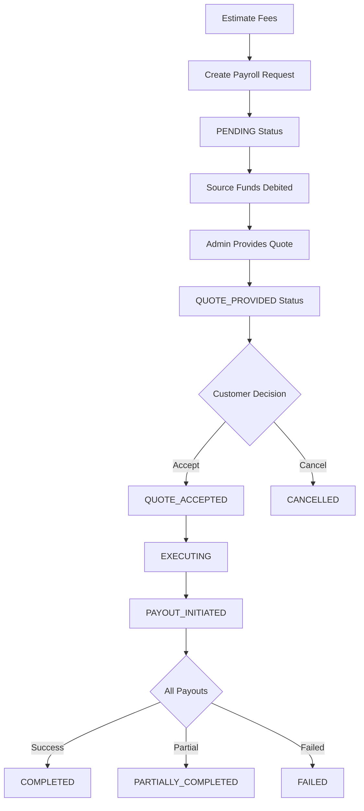

# Payroll API Documentation

This guide provides comprehensive details for integrating with the **Relm Payroll API**. It covers endpoints for managing multi-currency payroll distributions, including fee estimation, request creation, quote acceptance, and transfer tracking.

- **Contact Support**: Reach out to [support@relm.co](mailto:support@relm.co) for assistance.

---

## Overview

The Payroll API enables businesses to distribute payments to multiple beneficiaries in different currencies efficiently. The system handles currency conversion, fee calculation, quote management, and individual beneficiary payout tracking.

### Key Features

- **Multi-Currency Support**: Pay beneficiaries in their local currency while deducting from a single source account
- **Transparent Fee Structure**: Detailed breakdown of spread fees, payment processor fees, and bank transfer fees
- **Quote-Based Workflow**: Request a quote, review it, and accept before execution
- **Beneficiary-Level Tracking**: Monitor individual payouts within a payroll batch
- **Immutable Audit Trail**: Beneficiary details snapshotted at request time for compliance

---

## Authentication

All Payroll API endpoints require authentication using a Bearer token. Include your access token in the `Authorization` header:

```
Authorization: Bearer <your_access_token>
```

For details on generating API signatures and obtaining access tokens, see the [Authentication Guide](https://docs.relm.co/auth).

---

## Base URLs by Environment

| Environment | Base URL                      |
| ----------- | ----------------------------- |
| Sandbox     | `https://sandbox.api.relm.co` |
| Production  | `https://api.relm.co`         |

---

## Payroll Workflow

The payroll process follows a structured workflow with clear status transitions:



### Status Definitions

| Status | Description |
|--------|-------------|
| **PENDING** | Initial state after request creation. Source funds have been debited and are held for the payroll. |
| **QUOTE_PROVIDED** | Admin has recorded the actual FX exchange rate and provided a quote to the customer. |
| **QUOTE_ACCEPTED** | Customer has accepted the quote and authorized execution. |
| **EXECUTING** | Payroll execution is in progress. |
| **PAYOUT_INITIATED** | Individual payouts to beneficiaries have been initiated. |
| **COMPLETED** | All beneficiaries have been successfully paid. |
| **PARTIALLY_COMPLETED** | Some beneficiaries were paid successfully, others failed. |
| **FAILED** | Payroll request failed completely. |
| **CANCELLED** | Request was cancelled by customer or admin. |

---

## Key Concepts

### Fee Hash

The fee hash is a time-limited token returned by the Estimate Fees endpoint. It represents a locked-in fee quote and must be included when creating a payroll request.

- **Validity**: Expires after a configured TTL (typically 10-15 minutes)
- **One-Time Use**: Consumed immediately upon request creation
- **Purpose**: Ensures fee consistency between estimate and execution

### Beneficiary Snapshots

When a payroll request is created, the system captures an immutable copy of each beneficiary's details (name, account info, etc.). This ensures:

- Historical accuracy for audit and compliance
- Independence from future beneficiary profile changes
- Clear record of who was paid and how

### Amount Currency Types

Payroll amounts can be specified in two ways:

- **SOURCE**: Amount denominated in the source account currency
- **PAYROLL**: Amount denominated in the beneficiary's payout currency

The system automatically calculates the complementary amount using the exchange rate with applied spread.

### Fee Breakdown

Payroll fees consist of three components:

1. **Spread Fee**: FX conversion markup applied to the exchange rate
2. **Fuse Fee**: Payment processor fee for source account debit
3. **MCB Fee**: Bank transfer fee per beneficiary (fixed amount in payroll currency)

All fees are transparently disclosed in the estimate and request responses.

---

## Endpoints

### Fee Estimation & Request Creation

- [**POST /payroll/estimate**](endpoints/estimate-payroll-fee) — Estimate fees for a payroll distribution
- [**POST /payroll/requests**](endpoints/create-payroll-request) — Create a new payroll request
- [**GET /payroll/requests/:requestId**](endpoints/get-payroll-request) — Get detailed payroll request information

### Quote Management

- [**PATCH /payroll/requests/:requestId/accept**](endpoints/accept-payroll-quote) — Accept the provided quote
- [**DELETE /payroll/requests/:requestId**](endpoints/cancel-payroll-request) — Cancel a payroll request

### Listing & Tracking

- [**GET /payroll/requests**](endpoints/list-payroll-requests) — List all payroll requests for the authenticated customer
- [**GET /payroll/transfers**](endpoints/list-payroll-transfers) — List individual beneficiary payouts with status tracking

### Reference

- [**Enums & Types**](endpoints/enums-and-types) — Status enums, transfer types, and MCB purpose codes

---

## Common Error Responses

The API returns standard HTTP status codes and JSON error responses:

### 400 Bad Request

```json
{
  "success": false,
  "error": {
    "code": "VALIDATION_ERROR",
    "message": "Invalid request parameters",
    "details": [
      {
        "field": "amount",
        "message": "Amount must be greater than zero"
      }
    ]
  }
}
```

### 401 Unauthorized

```json
{
  "success": false,
  "error": {
    "code": "UNAUTHORIZED",
    "message": "Invalid or expired authentication token"
  }
}
```

### 404 Not Found

```json
{
  "success": false,
  "error": {
    "code": "NOT_FOUND",
    "message": "Payroll request not found or access denied"
  }
}
```

### 500 Internal Server Error

```json
{
  "success": false,
  "error": {
    "code": "INTERNAL_ERROR",
    "message": "An unexpected error occurred. Please contact support."
  }
}
```

---

## Rate Limits

API rate limits apply per customer account:

- **Sandbox**: 100 requests per minute
- **Production**: 60 requests per minute

Exceeding rate limits returns a `429 Too Many Requests` response with a `Retry-After` header.

---

## Support & Resources

- **Developer Portal**: [https://docs.relm.co](https://docs.relm.co)
- **API Status**: [https://status.relm.co](https://status.relm.co)
- **Support Email**: [support@relm.co](mailto:support@relm.co)

---

## Changelog

### 2026-06-05
- Initial Payroll API documentation published
